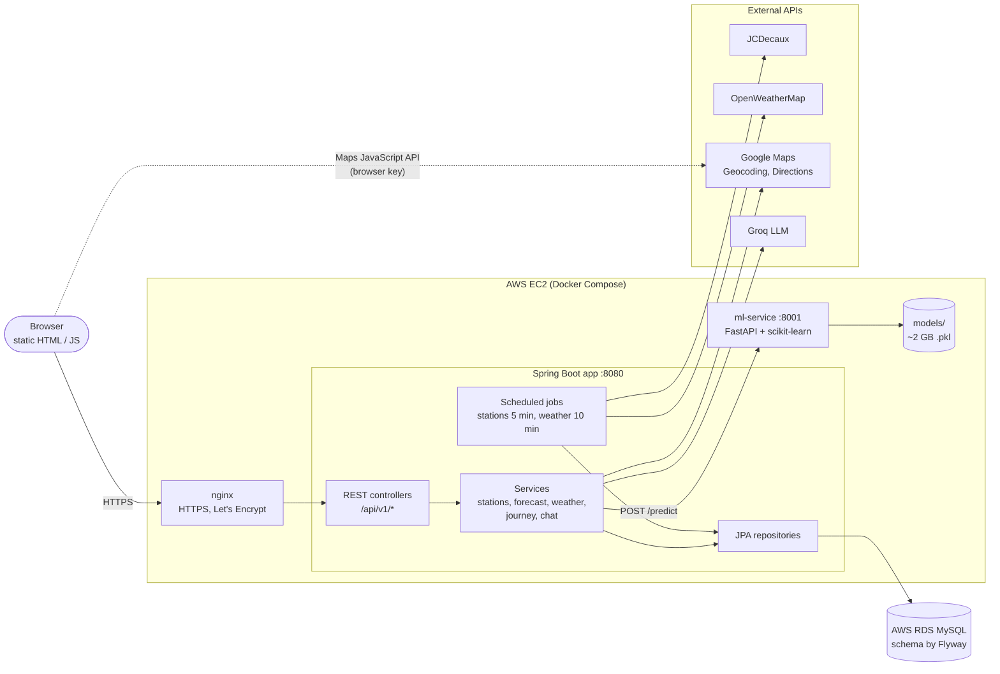
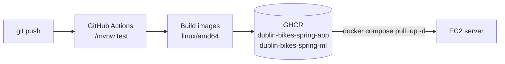

# Dublin Bikes (Spring Boot)

Real-time bike-share planner for Dublin: live station availability, weather, journey planning with ML-predicted availability, and an AI assistant.

Live at **https://bikes.seancai.dev**

This repository is a Spring Boot rewrite of the backend of a Python/Flask group project. The frontend (HTML, CSS, JavaScript) is reused unchanged. It is also a learning project: it was built part by part from a test-driven workbook (see [Studying with an AI agent in a responsible way](#studying-with-an-ai-agent-in-a-responsible-way)).

## Features

- **Live stations**: all dublinbikes stations on a map, refreshed from JCDecaux every 5 minutes and stored in MySQL.
- **Nearest stations**: the stations closest to a point, optionally only those with bikes.
- **Availability forecast**: predicted bikes per station for the next 1 to 48 hours, from Random Forest models served by a Python service. When that service is down, the API still answers with the live count and a `degraded` flag (retry + circuit breaker).
- **Weather**: current weather and hourly forecast from OpenWeatherMap, stored every 10 minutes and cached.
- **Journey planner**: geocodes the start and end addresses with Google Maps, picks the nearest stations with bikes and free stands, and returns walk / cycle / walk legs with turn-by-turn steps. A "depart at" mode uses the forecast to pick stations that should still have bikes when you arrive.
- **AI assistant**: a chat endpoint backed by Groq, with live station availability in the system prompt.

## Architecture



Requests from the browser go through nginx to the Spring Boot app. The scheduled jobs are the only writers of station and weather data, and the station and weather APIs only read from the database, so a slow external API never slows down those pages. Calls to the ML service, Google Maps and Groq happen per request, and each kind of failure is mapped to its own HTTP status (for example 404 when an address is not found, 502 when Google cannot build a route).

How a commit reaches production:



## Tech stack

| Layer | Technology |
|---|---|
| Backend | Java 25, Spring Boot 4 (Spring Framework 7, Hibernate 7, Jackson 3) |
| HTTP clients | `RestClient`, declarative `@HttpExchange` interfaces |
| Resilience and caching | Resilience4j (retry, circuit breaker), Caffeine with `@Cacheable` |
| Database | MySQL 8 on AWS RDS, schema managed by Flyway; H2 for tests |
| Docs and ops | springdoc OpenAPI (Swagger UI), Actuator health checks |
| ML inference | Python FastAPI service serving scikit-learn Random Forest models |
| External APIs | JCDecaux, OpenWeatherMap, Google Maps, Groq |
| Hosting | AWS EC2, nginx, Let's Encrypt, Docker images on GitHub Container Registry |

## Project structure

```
src/main/java/ie/dublinbikes/
├── station/     stations: JPA entities, JCDecaux ingest job, query service, REST API
├── jcdecaux/    JCDecaux API client
├── forecast/    client for the ML service, retry + circuit breaker, forecast API
├── weather/     OpenWeatherMap client, weather ingest job, weather API
├── journey/     Google Maps client (@HttpExchange), journey planner, predictive journeys
├── chat/        Groq client and the AI assistant API
├── ops/         ML service health indicator, OpenAPI settings
├── config/      shared beans and configuration properties
└── web/         global error handling (ProblemDetail)
src/main/resources/
├── application.yml, application-mysql.yml
├── db/migration/        Flyway migrations (V1 stations, V2 weather)
└── static/              frontend reused from the Flask project
ml-service/              Python FastAPI inference service and its Dockerfile
src/test/java/           161 tests, one group per workbook part (Part1 ... Part17) plus FinalApplicationTest
compose.yaml             local stack: app + ml-service + MySQL
compose.rds.yaml         override: use AWS RDS instead of local MySQL
compose.prod.yaml        production: pull images from GHCR, use RDS
.github/workflows/ci.yml tests, then build and publish the Docker images
```

## API

Interactive documentation is at `/swagger-ui.html` (OpenAPI JSON at `/v3/api-docs`).

| Method | Path | Description |
|---|---|---|
| GET | `/api/v1/stations` | All stations with their latest availability |
| GET | `/api/v1/stations/{number}` | One station |
| GET | `/api/v1/stations/nearest?lat=&lng=&limit=&requireBikes=` | Stations nearest to a point |
| GET | `/api/v1/stations/{number}/forecast?hours=` | Predicted availability for the next 1 to 48 hours |
| GET | `/api/v1/weather/current` | Latest stored weather |
| GET | `/api/v1/weather/forecast?limit=` | Upcoming hourly forecast |
| POST | `/api/v1/journeys` | Plan a journey now: `{"start": "...", "end": "..."}` |
| POST | `/api/v1/journeys/predict` | Plan a journey for later; `departAt` is Dublin local time |
| GET | `/api/v1/journeys/config` | Browser Maps key for the frontend |
| POST | `/api/v1/chat` | Ask the AI assistant |
| GET | `/actuator/health` | Health of the app, the database and the ML service |

Errors use the standard `application/problem+json` format. The frontend still calls the old Flask URLs; `static/js/api-compat.js` translates them to `/api/v1`.

## Running locally

1. Copy `.env.example` to `.env` and fill in the API keys (see [Configuration](#configuration)).
2. Put the model files in `ml-service/models/` (about 2 GB, not stored in git).
3. Start everything, with a local MySQL container:

   ```bash
   docker compose up --build
   ```

The app is at http://localhost:8080 and the API docs at http://localhost:8080/swagger-ui.html.

Without Docker, you can run the app alone on the in-memory H2 database. Forecasts are then marked `degraded`, because there is no ML service.

```bash
SCRAPER_ENABLED=true ./mvnw spring-boot:run
```

## Configuration

Settings come from environment variables, read from `.env`. `.env` is ignored by git; `.env.example` lists every variable.

| Variable | Used for |
|---|---|
| `JCDECAUX_API_KEY` | Live station data |
| `OPENWEATHER_API_KEY` | Weather |
| `GOOGLE_MAPS_API_KEY` | Map in the browser (restrict it by HTTP referrer) |
| `GOOGLE_MAPS_SERVER_KEY` | Geocoding and Directions from the server (restrict it by IP) |
| `GROQ_API_KEY`, `GROQ_MODEL` | AI assistant |
| `SCRAPER_ENABLED` | Turns the scheduled station and weather jobs on. Off by default, so tests and local runs do not call the APIs |
| `FORECAST_BASE_URL` | URL of the ML service (default `http://localhost:8001`) |
| `RDS_HOST`, `RDS_PORT`, `RDS_DATABASE`, `RDS_USER`, `RDS_PASSWORD` | AWS RDS connection, used by `compose.rds.yaml` and `compose.prod.yaml` |

## Tests

```bash
./mvnw test                      # all 161 tests
./mvnw test -Dtest='Part15*'     # one workbook part
```

Tests use an in-memory H2 database and stub every external service (MockRestServiceServer, Mockito), so they need neither Docker nor API keys. CI runs them on every push and pull request.

## Using AWS RDS

1. On the RDS instance, create a database and user for this app. Do not reuse the Flask project's databases: their tables have the same names but a different structure, and Flyway refuses to run on a non-empty schema.

   ```sql
   CREATE DATABASE dublin_bikes_spring;
   CREATE USER 'bikes_spring'@'%' IDENTIFIED BY '<strong password>';
   GRANT ALL PRIVILEGES ON dublin_bikes_spring.* TO 'bikes_spring'@'%';
   ```

2. Allow inbound MySQL (port 3306) in the RDS security group from wherever the app runs, ideally the EC2 instance's security group.
3. Set `RDS_HOST`, `RDS_USER` and `RDS_PASSWORD` in `.env`, then start without the local MySQL container:

   ```bash
   docker compose -f compose.yaml -f compose.rds.yaml up --build app ml-service
   ```

Flyway creates the tables on the first start.

## Deployment

Every push runs the tests in GitHub Actions and then publishes two `linux/amd64` images to GitHub Container Registry: `ghcr.io/seanchoy/dublin-bikes-spring-app` and `ghcr.io/seanchoy/dublin-bikes-spring-ml`. Each image is tagged with the branch name and the commit SHA, and with `latest` on the default branch.

The server is an Ubuntu EC2 instance in the same VPC as the RDS database. `/srv/dublin-bikes-spring/` on the server holds `compose.prod.yaml` (saved as `compose.yaml`), a `.env` file and the `models/` folder. To deploy a new version:

```bash
docker compose pull
docker compose up -d
```

`IMAGE_TAG` in `.env` picks the image version (default `latest`). The app listens only on `127.0.0.1:8080`. nginx in front of it terminates HTTPS with a Let's Encrypt certificate (renewed by certbot) and redirects HTTP to HTTPS. The Google server key must allow the server's Elastic IP.

## Studying with an AI agent in a responsible way

I built this project to learn Spring Boot, coming from basic Java and Python/Flask. An AI coding agent acted as tutor and examiner: it set the tasks and wrote the tests, and I wrote the Spring Boot backend myself.

### Who did what

| AI agent | Me |
|---|---|
| Read the Flask code and split the migration into 17 parts, from records and streams (Part 1) to calling an LLM (Part 17) | Wrote the Spring Boot backend: entities and repositories, services, REST controllers, HTTP clients, scheduled jobs, error handling and configuration |
| For each part, wrote a spec with example input and output, TODO skeletons in `src/main/java` and the tests in `src/test/java` | Made each part's tests pass without editing them, running them part by part: `./mvnw test -Dtest='Part7*'` |
| Answered concept questions as they came up | Asked the questions and kept the answers as interview notes |

### How I worked through each part

1. Read the part's spec and concepts.
2. Find the `TODO 7.2a`-style markers in `src/main/java` and write the code.
3. Run that part's tests.
4. When everything is green, commit and move to the next part.

### Prompts that worked

Instead of repeating long prompts, I wrote them down once as an agent skill, *OA-style workbook*: it turns a real project into exam-style (OA) exercises and then coaches me through them. A short request such as *"turn this Flask project into a Spring Boot workbook"* is enough, because the skill tells the agent how to do the rest:

1. **Scope.** Find out what I already know, my goal and my time, then pick a vertical slice that touches every layer once (external API → scheduled ingest → database → REST API → UI).
2. **Design the parts.** Order them from plain language features to framework integration. Each part has 3–5 numbered tasks written like an OA question (spec, constraints, example input and output, a "new requirement" twist) and ends with interview questions.
3. **Write the spec.** For each part: the files to edit and the test command, concepts explained with examples from a different domain so they don't give the answer away.
4. **Coach.** Run my tests and read the real cause, explain why before how, never edit my code, bridge from Python to Java, and write small runnable demos for abstract ideas such as proxies.
5. **Keep interview notes.** Log every concept question with my first answer, the key points and a short version I could say in an interview.

Typical follow-up requests:

- *"I'm on Part 13. Check the remaining parts, add the context I'm missing and refine them."*
- *"Write extra tests for the edge cases of 12.2: an empty forecast, a duplicate timestamp."*

### What made it work

- **Tests come first and stay fixed.** I never edit `src/test`. Asking for more tests is fine; asking the agent to change a test so my code passes is not.
- **One vertical slice at a time.** Each part touches only what it needs, and later parts build on earlier ones, so the app ran after every part.
- **Precise specs.** When a spec was vague (for example, whether a timestamp meant "now" or "when the data was fetched"), I had the agent fix the spec, not just answer me once.

## Credits

This is a rewrite of the original Python/Flask version, [shayan-chakraborty1664/dublin-bikes-team20](https://github.com/shayan-chakraborty1664/dublin-bikes-team20). It was built as a university group project with Shayan Chakraborty, Jialin Wang and Leah Unnikrishnan, and the frontend and forecasting models used here come from it.
